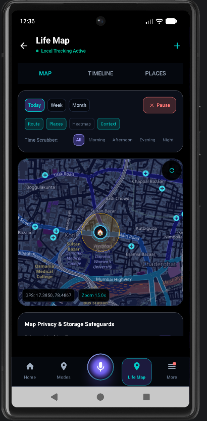
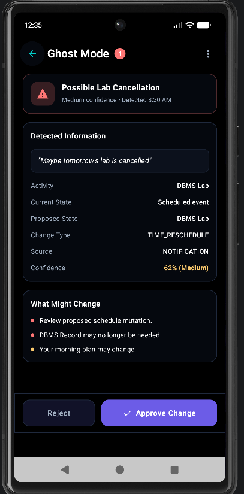

# LIFEOS — Life Operating System

LIFEOS is an Android application designed to make everyday life easier to organize and manage. It brings together activity-based checklists, readiness tracking, contextual reminders, personal memory, and planning assistance in a single application.

Rather than treating every reminder as an isolated task, LIFEOS aims to connect daily activities with the context around them. The project focuses on helping users prepare for activities, understand what needs attention, and make more informed decisions about their schedules.

## Features

### Life Modes and Readiness
- Create and manage activity modes for college, work, gym, sports, travel, shopping, and other routines.
- Build custom checklists for different activities.
- Track readiness based on configured requirements.
- Edit, organize, and manage checklist items.

### Context-Aware Assistance
- Context recognition using supported device signals and application data.
- Departure-related reminders to help users prepare for journeys.
- Notification ingestion where the required Android permissions are granted.
- Contextual planning suggestions based on available information.

### Personal Planning and Memory
- **Life Graph:** Organize relevant events and personal context.
- **Ghost Mode:** Review proposed plan changes and schedule-related suggestions.
- **Memory Vault:** Manage supported personal memory information.
- **Virtual Executive Secretary:** Provide a central interface for planning and assistance.
- **Time Audit:** Review supported activity and time-related information.

### Additional Capabilities
- Interactive Life Map interface.
- Voice assistant interface.
- Emergency SOS functionality.
- Smart clipboard features.
- Privacy controls and safe-mode functionality.
- Local data storage and offline-oriented workflows where supported.

Feature availability depends on the implementation, Android version, granted permissions, and any required external services.

## Screenshots

### Home Dashboard

The main dashboard brings together daily readiness and contextual information.


### Life Modes and Checklists

Organize requirements for different activities and review what needs attention.


### Interactive Life Map

Explore the application's map interface for location-aware features.



### Ghost Mode

Explore the interface for reviewing proposed changes to plans and schedules.



### More Screens

Additional screenshots covering the Voice Assistant, Memory Vault, Time Audit, Settings, and other features are available in [`docs/screenshots/`](docs/screenshots/).

## Technology Stack

| Component | Technology |
|---|---|
| Language | Kotlin |
| UI Framework | Jetpack Compose |
| Design System | Material 3 |
| Local Database | Room |
| Background Processing | WorkManager |
| Location Services | Google Play Services Location |
| Map Integration | osmdroid |
| Build System | Gradle with Kotlin DSL |
| Testing | JUnit and Android testing tools |

## Architecture

LIFEOS is organized into application, data, engine, service, security, and UI layers.

```text
LIFEOS
│
├── app/
│   └── src/
│       ├── main/
│       │   ├── java/com/lifeos/app/
│       │   │   ├── data/       # Database and repositories
│       │   │   ├── engine/     # Context, readiness and planning logic
│       │   │   ├── security/   # Privacy and data controls
│       │   │   ├── service/    # Background and system integrations
│       │   │   └── ui/         # Compose screens and navigation
│       │   └── res/            # Android resources
│       ├── androidTest/        # Instrumented tests
│       └── test/               # Unit and integration tests
│
├── docs/
│   └── screenshots/
├── gradle/
├── .gitignore
├── build.gradle.kts
├── gradle.properties
├── gradlew
├── gradlew.bat
├── settings.gradle.kts
└── README.md
```

## Getting Started

### Prerequisites

- Android Studio.
- A compatible Android SDK and JDK for the project's Gradle configuration.
- An Android emulator or a physical Android device.
- Internet access for downloading Gradle dependencies during initial setup.

### Clone the Repository

```bash
git clone https://github.com/Dinesh31698/LIFEOS.git
cd LIFEOS
```

### Open and Run

1. Open the cloned project in Android Studio.
2. Allow Gradle synchronization to finish.
3. Start an Android emulator or connect a device with USB debugging enabled.
4. Select the `app` run configuration.
5. Build and run the application.

### Build a Debug APK

On Windows, run the following command from the project root:

```powershell
.\gradlew.bat assembleDebug
```

On Linux or macOS:

```bash
./gradlew assembleDebug
```

The debug APK is normally generated at:

```text
app/build/outputs/apk/debug/app-debug.apk
```

### Run Unit Tests

On Windows:

```powershell
.\gradlew.bat testDebugUnitTest
```

On Linux or macOS:

```bash
./gradlew testDebugUnitTest
```

Review the Gradle output to confirm whether the build and tests complete successfully.

## Privacy and Permissions

LIFEOS may use Android permissions for location, notifications, activity-related information, and other supported device integrations.

- Grant permissions only when you understand why a feature needs them.
- Review privacy and safe-mode settings before enabling integrations.
- Keep API keys, passwords, signing keys, personal records, and private configuration files out of version control.
- Remember that background execution and location access are subject to Android's permission and battery-management rules.

Some features may require an internet connection or external services. Offline availability depends on the individual feature.

## Project Status

LIFEOS is an actively developed Android project. Features, interfaces, and integrations may evolve as development and testing continue.

## Contributing

Suggestions, bug reports, and improvements are welcome.

When reporting an issue, include:
- A clear description of the problem.
- Steps to reproduce it.
- Relevant error messages or screenshots.
- Android version and device information, where applicable.

## License

No license has been added to this repository yet. Until a license is selected and published, assume that the project is not available for unrestricted reuse, modification, or redistribution.

