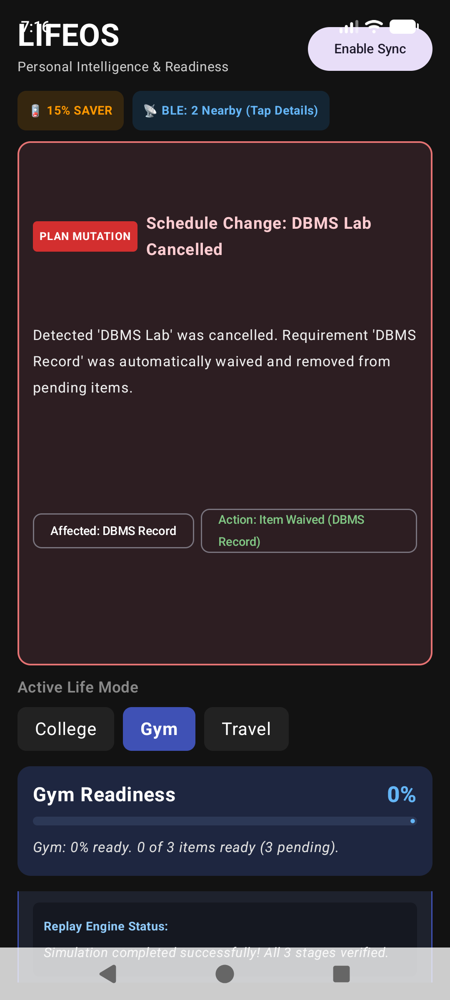
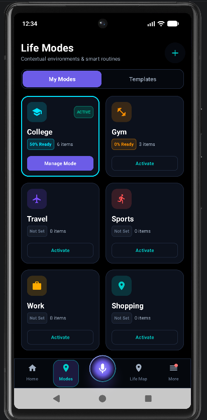
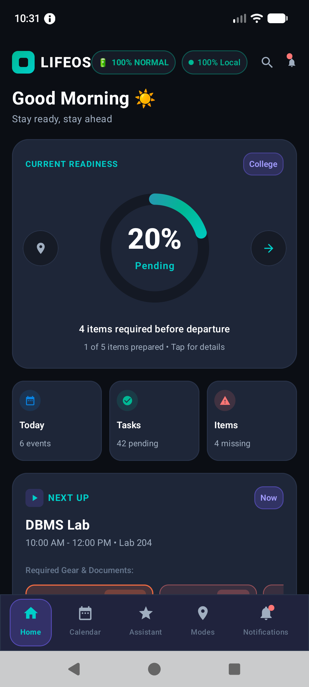

# LIFEOS — Life Operating System

LIFEOS is an Android application designed to help people manage everyday life with better context, planning, and awareness. Instead of treating reminders and checklists as isolated tasks, LIFEOS brings together personal routines, activity requirements, contextual signals, and readiness information in one place.

The project is built with Kotlin and Jetpack Compose, with a focus on practical daily assistance, local data management, and user control.

## Features

- **Life Modes:** Organize requirements and checklists for activities such as college, work, gym, sports, travel, and shopping.
- **Readiness Tracking:** Review activity-specific requirements and identify what still needs attention.
- **Context Recognition:** Support context-aware assistance using available device and application signals.
- **Smart Departure:** Help users prepare for journeys with departure-related reminders.
- **Custom Checklists:** Create, edit, rename, and organize requirements for personal activities.
- **Planning Assistance:** Explore proposed plan changes and consequence-aware suggestions.
- **Life Graph and Memory:** Organize relevant life events and personal context.
- **Privacy Controls:** Provide settings for managing supported data access and application behavior.
- **Offline-Oriented Design:** Keep core functionality available locally where supported; features that depend on external services or device permissions may require connectivity or additional setup.

## Screenshots

### Home Dashboard



### Life Modes



### Context Recognition


### Smart Departure



## Technology Stack

- **Language:** Kotlin
- **UI:** Jetpack Compose and Material 3
- **Database:** Room
- **Background Tasks:** WorkManager
- **Location Services:** Google Play Services Location
- **Map Integration:** osmdroid
- **Build System:** Gradle with Kotlin DSL
- **Testing:** JUnit and Android unit tests

## Project Structure

```text
LIFEOS/
├── app/
│   └── src/
│       ├── main/
│       │   ├── java/
│       │   ├── res/
│       │   └── AndroidManifest.xml
│       └── test/
├── docs/
│   └── screenshots/
├── gradle/
├── .gitignore
├── build.gradle.kts
├── gradle.properties
├── gradlew
├── gradlew.bat
├── settings.gradle.kts
└── README.md
```

## Getting Started

### Requirements

- Android Studio with a compatible Android SDK
- JDK version supported by the project's Gradle configuration
- Android emulator or a physical Android device

### Run Locally

1. Clone the repository:

   ```bash
   git clone https://github.com/Dinesh31698/LIFEOS.git
   ```

2. Open the project in Android Studio.
3. Allow Gradle to sync and download the required dependencies.
4. Select an emulator or connect an Android device with USB debugging enabled.
5. Build and run the `app` configuration.

On Windows, you can also build the debug APK from the project directory:

```powershell
.\gradlew.bat assembleDebug
```

Run the local unit tests with:

```powershell
.\gradlew.bat testDebugUnitTest
```

## Privacy and Permissions

LIFEOS may use device permissions for features such as location, notifications, usage information, or other supported integrations. Available functionality depends on the permissions granted and the configuration of the device.

Review permission requests before enabling features. Do not commit API keys, signing keys, passwords, private configuration files, or personal data to the repository.

## Project Status

LIFEOS is an actively developed project. Features, interface details, and integrations may change as development and testing continue.

## Contributing

Suggestions, bug reports, and improvements are welcome. Please describe the issue clearly and include reproducible steps when reporting a bug.

## License

No license has been added yet. Until a license is included in the repository, do not assume that the source code is available for unrestricted reuse or redistribution.
